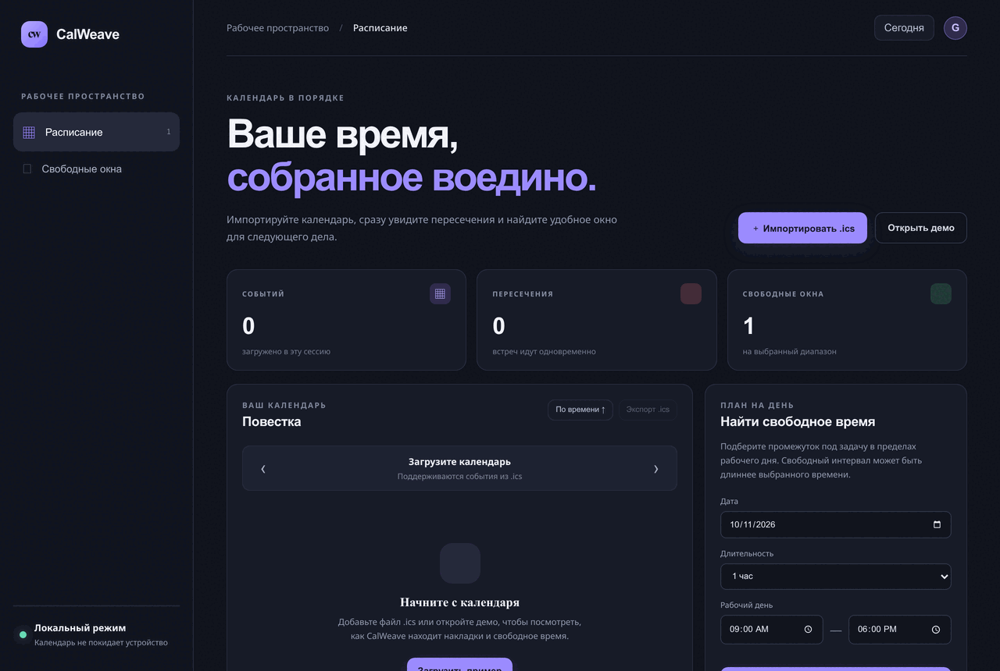

# CalWeave

**Локальный планировщик календарных файлов `.ics`: повестка, пересечения встреч и поиск свободных окон.**



CalWeave читает выбранный календарный файл в браузере, показывает встречи по дням, отмечает временные пересечения и помогает найти интервалы нужной длительности в заданных рабочих часах. Можно экспортировать список обратно в `.ics`.

## Запуск

Нужен Node.js 20 или новее. Из папки проекта:

```bash
npm start
```

Откройте `http://127.0.0.1:4173`. Приложение работает локально и не отправляет календарь на сервер. Для разработки доступны `npm test` и `npm run check`.

## Возможности

- Импорт `.ics` через локальный выбор файла и примерный календарь.
- Повестка по дням, поиск пар пересекающихся событий, переход по датам.
- Поиск свободных интервалов с настройкой длительности и рабочего дня.
- Экспорт `.ics`, UTF-8 складывание строк и сохранение неизвестных свойств событий.
- Никаких аккаунтов, аналитики, внешних шрифтов, API или runtime-зависимостей.

## Ограничения формата

Это небольшой поднабор iCalendar, а не полный парсер RFC 5545. Поддержаны `VEVENT`, `UID`, `SUMMARY`, `DESCRIPTION`, `LOCATION`, `DTSTART` и `DTEND`; даты UTC с `Z`, плавающие локальные даты-время и события на весь день. Неизвестные свойства и `RRULE` сохраняются при экспорте. Повторяющиеся события не разворачиваются в экземпляры. `TZID` сохраняется и сопровождается предупреждением, но расчёт выполняется как для локального плавающего времени; часовые пояса из `VTIMEZONE` не рассчитываются. События на весь день по умолчанию исключены из поиска временных пересечений и свободных окон; `findConflicts(events, { includeAllDay: true })` включает их в проверку диапазонов.

Плавающее время интерпретируется в часовом поясе текущего устройства. CalWeave не меняет исходный файл при импорте; изменённую копию создаёт только по нажатию экспорта.

## Разработка

`calendar-core.js` — независимое от DOM ES-модульное ядро; тесты запускаются встроенным `node:test` без пакетов. `server.mjs` запускает лёгкий локальный сервер для модулей и предоставляет файлы только из каталога проекта.

## Лицензия

MIT. См. [LICENSE](LICENSE).
